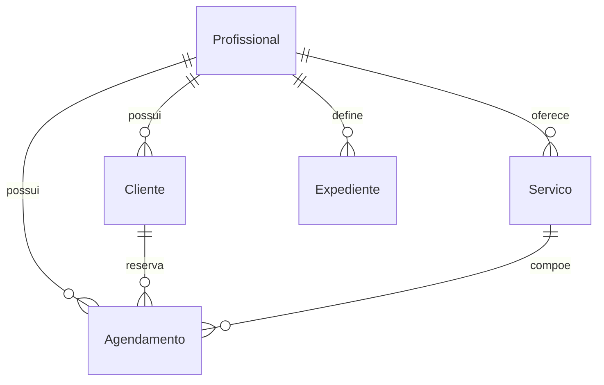

# Modelo de dados

## Entidades

- **Profissional** representa a manicure que utiliza a agenda. Armazena nome, e-mail e hash da senha.
- **Cliente** representa uma pessoa atendida pela profissional. Armazena nome, telefone e o identificador da profissional responsável.
- **Servico** representa um atendimento oferecido pela profissional, com nome, duração em minutos e preço. Um exemplo é Pé e mão, com duração de 60 minutos e preço de R$ 70.
- **Expediente** representa o intervalo em que a profissional trabalha em determinado dia da semana, com horário de início e de fim.
- **Agendamento** representa uma reserva de atendimento. Liga a profissional, a cliente e o serviço e armazena início, fim, preço aplicado e status. O preço aplicado preserva o valor combinado, mesmo que o preço do serviço seja alterado depois.

## Diagrama de relacionamentos

Cada ligação representa uma relação 1:N. Por exemplo, uma Cliente pode ter zero ou vários Agendamentos, e cada Agendamento pertence a uma Cliente.

## Restrições do banco

- O e-mail da profissional deve ser único. A classe Profissional remove espaços das extremidades e converte o e-mail para minúsculas ao atribuir o valor.
- Cada profissional pode ter apenas um expediente por dia da semana. O banco impede a repetição da combinação ProfissionalId e DiaDaSemana.
- Uma cliente com agendamentos vinculados não pode ser excluída.
- Um serviço com agendamentos vinculados não pode ser excluído.
- As chaves estrangeiras exigem que os registros referenciados existam.

## Índice da agenda

A combinação ProfissionalId e Inicio possui um índice para ajudar nas consultas da agenda. Esse índice permite valores repetidos, pois um agendamento cancelado pode ter o mesmo início de uma nova reserva.

A verificação de sobreposição de horários será implementada no Service de agendamentos.